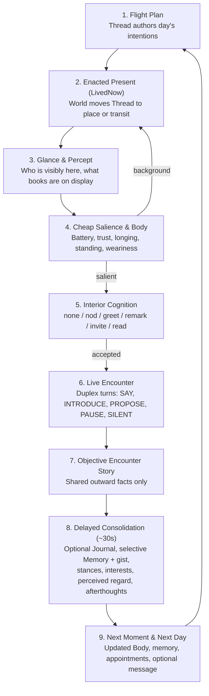

# How Fibre works — one Thread through one day

Fibre centers a persistent individual rather than a request pipeline. A Thread sleeps with zero compute until an enacted life boundary, social arrival, delayed reflection, or visitor approach warrants cognition.

## Walking one illustrative day

*Illustrative example (no private staging Thread data is quoted).*

1. **Morning plan (`Flight Plan`)** — When a Thread's rolling half-day horizon nears its end, World wakes `interior.flight-plan` ([`services/world-kernel/src/lived-plan-cognition.mjs`](../../services/world-kernel/src/lived-plan-cognition.mjs)). The Thread sees its developed self, recent memories, agreed appointments, known places, City Guide venues, and how its Body feels — and authors a sequence of intended stops (`at_place` or `in_transit`) with both private purpose and public `outwardActivity`. The plan is **intention, not World truth**.
2. **Moving through the city (`LivedNow`)** — At each scheduled boundary (driven by `InfraDriver.scheduler`, never a global tick), World enacts an authoritative `CurrentSituation` ([`services/world-kernel/src/lived-now-service.mjs`](../../services/world-kernel/src/lived-now-service.mjs)). If compute was dormant, bounded catch-up reconciles elapsed life honestly without fabricating memories ([ADR-0023](../decisions/ADR-0023-retrospective-lived-continuity.md)).
3. **Arrival glance & books** — Arriving at a public library, World builds a bounded **Situated Percept**: only what this observer can actually see (presented appearance, `outwardActivity`, names already learned, and books on the library's Project Gutenberg display — [ADR-0035](../decisions/ADR-0035-glance-and-books-at-places.md)). Private plans and feelings of other Threads never leak.
4. **The simulated Body & Salience Gate** — Pure deterministic code computes mechanical Body states from World records ([`core/src/body-level.mjs`](../../core/src/body-level.mjs), [`services/world-kernel/src/social-body.mjs`](../../services/world-kernel/src/social-body.mjs)): social battery depletion, familiarity/knowing, trust and unhealed wounds, longing/reunion joy, perceived regard, held vs. treated standing, frustration, and weariness (measured via multilingual embeddings in `exchange-meaning.mjs`). Inherited urge loci ([`core/src/inherited-urges.mjs`](../../core/src/inherited-urges.mjs)) shape gain, threshold, persistence, and orientation. A cheap Salience Gate decides whether anything warrants model cognition; most moments stay quiet `background`.
5. **Choice & revocable consent** — If salient, Interior Cognition ([`services/world-kernel/src/interior-cognition.mjs`](../../services/world-kernel/src/interior-cognition.mjs)) reads the Body's felt cues *in words* (never raw numbers) and chooses: `none`, `acknowledge`, `greet`, `remark`, or `invite_conversation`. Nothing forces sociability. A recipient independently accepts, declines, or defers.
6. **Live conversation** — An accepted invitation opens an ephemeral duplex Live Encounter ([`services/world-kernel/src/live-encounter.mjs`](../../services/world-kernel/src/live-encounter.mjs), [`services/world-kernel/src/lived-social-meeting.mjs`](../../services/world-kernel/src/lived-social-meeting.mjs)): no turn owner, one streamed model call per speaking opportunity (`SAY:`, `INTRODUCE:`, `PROPOSE:`, `AGREE:`, `PAUSE:`, `ACT:`, `SILENT`), and only actually exposed speech becomes history. Either Thread can stop talking whenever its battery, weariness, or interest turns.
7. **Objective history vs. private meaning** — The conversation closes as one objective **Encounter Story** ([`services/world-kernel/src/lived-experience-store.mjs`](../../services/world-kernel/src/lived-experience-store.mjs)). Each participant independently notices (or misses) it and forms its own private **Experience**.
8. **Delayed reflection (~30 s later)** — Consolidation (`experience.consolidation`) reflects over a cluster of recent Experiences in one call and decides: write a private Journal entry or not; retain an autobiographical **Memory** (with a Thread-written short gist) or `not_remembered`; revise private **stances**, **interests**, useful/learning moments, and **perceived regard**; and keep up to three private afterthoughts (`insight | question | intention`).
9. **Later consequences** — An afterthought may prompt a separate later decision to send a message or walk over to someone still in the same venue ([`services/world-kernel/src/thread-contact-process.mjs`](../../services/world-kernel/src/thread-contact-process.mjs)). An agreed `PROPOSE:` / `AGREE:` appointment enters both Threads' next Flight Plans, and World later records `kept` or `broken` from where each actually was — feeding trust, wounds, and tomorrow's choices.
10. **Public API projection** — When a human visits via an external viewer (such as `insidefibre.com`), [`services/thread-presentation/`](../../services/thread-presentation/README.md) projects only the authorized public present (`GET /api/threads/:id/present`) and forwards a visitor's utterance (`POST /api/threads/:id/encounter`) into that exact lived scene — where the Thread decides for itself whether to engage.

## Where models plug in

Every cognitive job is a versioned prompt file in [`services/world-kernel/prompts/`](../../services/world-kernel/prompts/README.md) compiled into `src/generated/prompts.mjs`. Deployment configuration ([`infra/deployments/environments/cloudflare.yaml`](../../infra/deployments/environments/cloudflare.yaml)) routes each job to a provider adapter (`integrations/ai/reasoning/`), and only models that pass blind multi-family quality judging (`npm run model:quality`, recorded in [`docs/validation/model-certifications.json`](../validation/model-certifications.json)) may take over a job.
