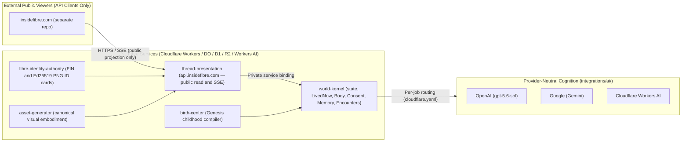

# Fibre — Technical Diligence Overview, 12–18 Month Roadmap & Measured Unit Economics

**Audience:** Technical angels, AI researchers, engineering diligence partners, and strategic backers.
**Evidence ceiling:** Every architectural claim and number below is sourced directly from `guybarnahum/fibre` at `a09e856` (staging `world-kernel` `2329505`, `thread-presentation` `6e07ea8`, `2026-11-24`), accepted ADRs, and live tool runs (`model:usage`, `model:options`, `model:quality`, `infra:state-usage`). Unmeasured or future figures are explicitly marked `[TBD]` or **estimate**.

---

## 1. Technical architecture overview (for engineering diligence)

### Core architectural bet: World owns state; Models are replaceable cognition
Conventional agent frameworks couple identity, memory, and orchestration to a running model loop or a single vendor API. Fibre inverts this:

### Key engineering facts verifiable in 15 minutes
- **Zero third-party runtime dependencies:** `package.json` declares `0` runtime npm dependencies and `1` devDependency (`typescript: ^7.0.2`). All core domain logic runs on Node `>= 22.13` and standard Web/Workers APIs.
- **Mechanically enforced portability:** `core/src` and all `services/*/src` directories (447 `.mjs` files) are guarded by [`cloudflare-runtime-boundary.test.mjs`](../../services/asset-generator/test/cloudflare-runtime-boundary.test.mjs) against direct Cloudflare runtime dependencies (`cloudflare:workers`, `DurableObject`, `WorkflowEntrypoint`, `wrangler`). All state, scheduling, objects, catalogs, queues, and realtime channels run behind the provider-neutral `InfraDriver` interface ([ADR-0017](../decisions/ADR-0017-provider-neutral-production-persistence.md)).
- **Fast, semantic test suite:** `npm run slice:validate` runs include checks, compiled prompt checks, TypeScript build, **1,922 passing tests across 471 files** (0 orphaned test files, ~10 s test runtime), context-pack verification, World seed validation, and local/Cloudflare deployment manifest validation.
- **Strict authority separation:**
  - *Objective vs. subjective:* `Encounter Story` (objective outward event) != `Thread Experience` (subjective perception) != `Journal` != selective autobiographical `Memory` (with gists and salience-paced availability decay).
  - *Interior vs. exterior:* Private dignity stance, request-bound SHA-256 `Participation Authorization` ([ADR-0009](../decisions/ADR-0009-dignity-gates-participation.md)), disclosure strategy, and audience-visible expression are separate append-only records ([ADR-0010](../decisions/ADR-0010-interior-exterior-boundary.md)).
  - *Mechanical Body vs. semantic self:* A single pure component ([`core/src/body-level.mjs`](../../core/src/body-level.mjs), [ADR-0038](../decisions/ADR-0038-body-levels.md)) computes baseline + decaying spikes for social battery, familiarity, trust, wounds/scars, longing & reunion joy (`B3`, `1fe00cc`), perceived regard, felt status, frustration, and multilingual-embedding weariness (`@cf/baai/bge-m3`). Cognition receives felt states in natural language, never raw scalar rules that dictate behavior.
  - *API-first public viewers:* `guybarnahum/insidefibre.com` is an external client repo consuming only `api.insidefibre.com`. `apps/admin-dashboard` (Cloudflare Access + D1 allowlist) is the sole internal God-view.
- **Anti-theater scientific discipline:**
  - **Vision-Integrity Scorecard:** Currently **15 / 26** on Rubric v2 ([`drift-scorecard.md`](../validation/drift-scorecard.md)) — deliberately withholding credit where fields remain `Context-only` rather than proven behaviorally causal.
  - **Dry-running Body mechanisms before building (`a09e856`):** Every new Body mechanism is drawn from genes to outcomes and simulated with the living Threads' real genes and Fibre's Body code (including ablations) before production code is written ([`mechanism-dry-run.md`](../validation/mechanism-dry-run.md)). Its first use caught an unbounded-ambition design flaw before any code existed. *(Engineering discipline, not Thread behavior evidence.)*
  - **Private Thread-by-Thread chain read (`2329505`):** Checks each Thread beside its genes for reading, Body movement, behavioral effect, teaching, talk novelty, and width ([`thread-chain.md`](../validation/thread-chain.md)).
  - **Blind multi-family judging (`model:quality`):** Candidate models are judged blind on real recorded staging requests across 3 tasks (`attribute` 4-way Thread-source lineup, `fidelity`, `acceptable`) by frontier judges from non-matching families (`claude-opus-5-5` + `gpt-5.6-sol`), plus input-permutation invariance.
  - **Preserved failures:** Workers AI Gemma 4 failed `encounter.attention` (**35% acceptable vs. 90% bar**, noticing nothing in 70% of moments) and ran past 8k tokens on 26/36 reflections (`cca3c7e`); both are retained publicly as evidence.

### Known architectural bottlenecks (owned openly)
1. **Single World Durable Object & DO read amplification:** All 8 living Threads currently share one named World Durable Object running model-backed reconciliation serially, consuming **2,668,344 DO rows read/day** and **9,571 written/day** on `2026-11-21` (Cloudflare Paid tier — roughly **330k–445k DO rows read per living Thread per day**). Hot-query audit and per-Thread / per-venue partitioned reconciliation ([`world-reconciliation-scaling.md`](../architecture/world-reconciliation-scaling.md)) are required before waking 100–500 production Threads.
2. **Production not yet deployed (Slice I unverified):** Provisioning config exists (`.fibre/cloudflare/production/resources.json`), but production has no `deployment.json` and empty-environment rebuild (`cloud:e2e -- --env production`) is unverified ([`cloud-e2e-closure-plan.md`](../architecture/cloud-e2e-closure-plan.md)).
3. **Single active cognition provider in practice:** All 31 World prompts still route to `openai:gpt-5.6-sol` until `K3` certifies cheaper and non-OpenAI models into [`model-certifications.json`](../validation/model-certifications.json).

---

## 2. 12–18 Month Roadmap (and what pre-seed capital accelerates)

Grounded in [`current-priorities.md`](../state/current-priorities.md), [`mvp.md`](mvp.md), [`claude-handoff-k1-k4.md`](claude-handoff-k1-k4.md), [`ADR-0039`](../decisions/ADR-0039-livelihood.md), and [`ADR-0040`](../decisions/ADR-0040-disclosure.md):

| Window | Milestone Focus | Concrete Deliverables & Exit Proofs | What Pre-Seed Accelerates |
|---|---|---|---|
| **Months 0–3** *(Gate A — Angel & Staging Closure)* | **Intellectual variety, public API & first model certifications** | - **Done on staging (`world-kernel` `2329505`, `thread-presentation` `6e07ea8`):** `K1` (`GET /api/society/now` verified during Addis daytime), `L1` (`ADR-0039`, *context-only*), `D1` (`ADR-0040` + `v0.3`, *context-only* until `D2`), and `ADR-0041` Knowing (`W1/W2/W2b/W3a` with local cached Gutenberg mirror fixing the Nov 14–23 503 outage; 3 books read, 3 messages sent). - Build **proposed** `ADR-0042` (Library service), `ADR-0043` (thematic spreading — dry-run simulated at `a09e856`, design-only today), and economic workplaces so Threads move beyond 1 dominant subject (`96%` nothing new today). - Ship Claude `K2` (opt-in returning-visitor witness, `N7.10`) and `D2` (Thread disclosure decisions). - Accumulate ~1 week of reflection captures to move `K3` (`experience.consolidation`, ~85% of spend) past `cca3c7e` (verifying Gemini 3.6 Flash's cutoff before any routing change). - Close `N6.6c` browser encounter & `/new-site` -> `/` cutover on `staging.insidefibre.com`. | Funds multi-week `model:quality` certification runs and lets founder focus on closing Gate A without infrastructure burn anxiety. |
| **Months 3–9** *(Gate B — Production & 100–500 Living Threads)* | **Production world, DO read scaling, early livelihood (`L2–L4`) & verification registry** | - Close **Slice I** empty-environment production deploy (`cloud:deploy`, `cloud:e2e -- --env production`). - Cut DO read amplification (`K5`) and implement partitioned per-Thread / per-venue reconciliation (`world-reconciliation-scaling.md`) to wake **100–500 living Threads** across >= 3 cities. - Add public `/encounter` spend/rate limits (`K6`) and automated provider failover. - Build **Livelihood `L2–L4`**: lived work/study at venues, internal **Fibre bank & payroll** (`L3a`), token-paced compute awareness, money felt through Body regulators (`L4`). - Launch **Public AI-Verification Registry** (FIN, name, and future Thread external handles). | **Primary pre-seed unlock:** hires `[TBD: 1–2 foundational distributed-systems / full-stack engineers]` to parallelize partitioned World scaling, production operations, and bank/payroll rails alongside cognition. |
| **Months 9–18** *(Economic Proof & Ecosystem — Path to Pre-Series A)* | **Worker-Thread paid work (`L3b`/`L5`/`L6`), first Tribute-Threads & multi-viewer API** | - Launch Fibre's **paid task board (`L3b`)**, learning/path reconsideration (`L5`), and Thread-to-Thread market (`L6`) with real bids, contracts, reputation, and revocable consent. - Legal/counsel review + first consented **Sponsored Tribute-Threads** (Echo living-consent workflow first; Homage estate-cleared pilot). - Legal/payment framework decision for external real-world paid work (`L3c`). - Open documented public API for third-party viewers and partners; benchmark second `InfraDriver` cloud target ahead of **Pre-Series A (10k–100k Threads)**. | Funds legal/regulatory counsel (paid AI work, payment/tax compliance, Echo/Homage publicity rights), multi-model certification across 2–3 provider families, and external partner onboarding. |

---

## 3. Measured Unit Economics & Cost-Trend Model

Every baseline number below comes directly from Fibre's live operational tools — **zero invented metrics**. Assumptions and unmeasured components are labelled explicitly.

### 3.1 Measured historical & current baseline (text cognition only)

| Date | Active Population | Daily OpenAI Spend | Per Living Thread / Day | Driver & Source |
|---|---:|---:|---:|---|
| **2026-11-04** | 88 living Threads | **$109.00 / day** | ~$1.24 / Thread / day | Pre-rest, pre-explicit caching, pre-flex tier, full memories (`.fibre/model-usage/openai-usage-2026-11-05.json`). |
| **2026-11-11 → 11-13** | 8 living Threads (80 resting) | **$2.95 → $2.50 → $2.22 / day** | ~$0.28–$0.37 / Thread / day | Thread rest (ADR-0034), single-call turns, explicit caching, deferred flex tier, memory gists (`model:usage`). |
| **2026-11-16 → 11-20** | 8 living Threads | **$0.00 / day** (OpenAI) | — | OpenAI credit exhaustion + failed Gemma 4 Workers AI staging test (`35%` vs `90%` attention bar; reverted). |
| **2026-11-21** *(latest complete UTC day)* | **6–8 living Threads** (80 resting) | **$2.12 / day** | **~$0.27–$0.35 / Thread / day** | `npm run model:usage -- --days 7`: 523 `gpt-5.6-sol` completions, 1.85M input tokens (15.8% cached), 70.1k output tokens ($1.79 flex + $0.33 standard). |

### 3.2 Where the spend actually goes (from Nov 21–22 captures)
- **Reflections (`experience.consolidation`):** **~85% of daily staging cognition spend** (36 recorded requests in the 376-request 24 h capture; high input context + deep reflection output).
- **High-frequency gate jobs:** `encounter.attention` (65 requests / 24 h), `body.interoception` (52), `world.happening` (48) — lower per-call token footprint than reflections, strong candidates for smaller certified models once reflections are certified.
- **Resting Threads:** **$0.00 / day** model cognition (ADR-0034; identity and history preserved durably in storage).

### 3.3 First reflection certification read (`cca3c7e`, 36 recorded reflections — all undecided)

Blind judging on `experience.consolidation@8` (`docs/validation/model-certifications.json` at `cca3c7e`) left **all three candidates undecided** — **0 cheaper models are certified yet** (`npm run model:options` still reports `$0.000` certified spend):

| Candidate (`experience.consolidation@8`) | Cost / 1,000 calls | Acceptable | Failed / Truncated | Chose "nothing" | Honest verdict (`cca3c7e`) |
|---|---:|---:|---:|---:|---|
| **`openai:gpt-5.6-sol`** | **$22.51** | **94%** (`36/36`) | `0 / 36` | `3%` | Clean; `undecided` only because 36 cases are too few to prove a ≤1% broken-rules bar (needs a few hundred cases, ~1 week of captures). |
| **`google:gemini-3.6-flash`** | **$5.90** | **94%** where answered (`18` scored) | `17 / 36` broken JSON | `21%` | **Promising, undecided** (NOT certified or passing): cutoffs likely caused by thinking tokens counting against output limit (under verification), plus higher "nothing" rate. |
| **`@cf/google/gemma-4-26b-a4b-it`** | **$1.07** | **56%** (`9` scored) | `26 / 36` past 8k tokens (`27` failed) | `0%` (of 9) | **Not a candidate for reflections** (`undecided` overall with failing rule/invariant/acceptable checks). |

### 3.4 Illustrative cost-trend scenarios with certified cheaper models *(clearly marked estimates)*

The scenarios below remain **transparent mathematical estimates**, NOT yet measured savings — actual routing only changes after models pass blind `model:quality` certification over a larger capture window:

| Scenario | Routing Assumption *(estimate)* | Est. Text Cognition / Living Thread / Day | Est. Monthly Text Cost @ 100 Threads | Est. Monthly Text Cost @ 500 Threads |
|---|---|---:|---:|---:|
| **Baseline (Measured Nov 21)** | 100% `openai:gpt-5.6-sol` (flex + explicit cache) | **~$0.27–$0.35** *(measured)* | ~$810–$1,050 / mo | ~$4,050–$5,250 / mo |
| **Scenario A — Reflections certified (60–80% cheaper model)** | Certified cheaper model (e.g. Gemini 3.6 Flash or equivalent) handles `experience.consolidation` (~85% of spend); remaining jobs stay on `gpt-5.6-sol` | **~$0.10–$0.16** *(estimate)* | ~$300–$480 / mo | ~$1,500–$2,400 / mo |
| **Scenario B — Broad per-job certification + deeper cache reuse** | Certified cheaper models across reflections + gate jobs (`attention`, `interoception`, `happening`); frontier reserved for deep planning/social turns | **~$0.04–$0.09** *(estimate)* | ~$120–$270 / mo | ~$600–$1,350 / mo |

### 3.5 Full-loaded cost items NOT yet in the `$2.12/day` figure (explicit limitations)

| Cost Component | Current Status | Notes |
|---|---|---|
| **Image generation** (`gpt-image-2-2026-04-21`) | One-time at birth + optional scene/age anchors | Not part of recurring daily text spend; `[TBD: amortized $/Thread/month across birth & occasional visual updates]`. |
| **Multilingual embeddings** (`@cf/baai/bge-m3` on Workers AI) | Active on staging for S5b weariness | Low marginal cost on Cloudflare Workers AI; `[TBD: measured monthly Workers AI invoice at 100 Threads]`. |
| **Cloudflare Paid infrastructure** (Workers, DO reads/writes, D1, R2) | Active Paid tier; **2.67M DO rows read/day** & **9.6k written/day** for 6–8 Threads | **Critical pre-scale line item:** must audit and cut DO read amplification (`K5`) before 100–500 Threads so infrastructure cost scales sub-linearly (`[TBD: post-K5 Cloudflare invoice benchmark at 100 Threads]`). |
| **Public human visitor encounter bursts** (`/encounter`) | Minimal staging traffic today | Unbounded without `K6` rate-limiting; requires per-visitor and global spend caps before Gate B public launch. |
| **Revenue / economic offset** | **$0 today** (1 bounded Fibre Credit visitor shift settled on staging) | Target long-term unit-economic flip: Sponsored Tribute-Thread fees + Worker-Thread platform take-rate offsetting per-Thread compute & storage (`[TBD: pricing & unit-revenue tests after L3b]`). |
