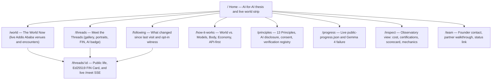

# Fibre — Live Site & Public Front-Door Specification (Phase 4 — Approved Direction)

**Owner decisions locked by Guy Bar-Nahum on 2026-11-22:**
- **Architecture & migration path:** Reimagine **`guybarnahum/insidefibre.com`** (`/Users/titan/github/insidefibre.com/`) as the unified public front door without losing existing value. Build and validate under **`/new-site`** first; once approved, move the current site to **`/old-site`** and promote the new experience to `/`, then remove `/old-site`.
- **Three-register visual system:**
  1. **Inspiration & Vision pages (`/`, vision/parable):** Universal living-world visual motifs — **flocks of birds (murmurations), schools of fish moving in emergent order** — echoing freedom, autonomous individuals, and order without a central controller.
  2. **Touching the Fibre World (`/world`, `/threads`, `/threads/:id` + `/meet`, `/following`):** Start in **Option A (*Field Journal & Living Atlas*)**, with a **live CSS theme toggle button** to switch cleanly into **Option B (*Quiet Observatory*)** so both styles can be evaluated side by side.
  3. **Deep Inspection & Diligence (`/inspect` or `/progress` + `/how-it-works` analytics/cost/mechanics):** A third register covering measured cost per Thread per day, model certifications, mechanics, and stats — naturally suited to **Option B (*Quiet Observatory*)** while still honoring the theme toggle.
- **Parallel `K1–K4` coordination:** Start at the surface now to guide Claude's `K1–K4` World-kernel implementation; exact expected contracts are published in [`docs/investment/claude-handoff-k1-k4.md`](claude-handoff-k1-k4.md).

**Architectural invariant:** Every public website is a **projection of the World, never a parallel World** ([`world-presentation.md`](../architecture/world-presentation.md), [`AGENTS.md`](../../AGENTS.md)). Public surfaces consume Fibre's public API (`api.insidefibre.com` / `api.staging.insidefibre.com`) strictly over HTTP/SSE, never read private World state, and never author a Thread's scene, mood, memory, or speech.
**Truth ceiling:** Every public capability claim renders from [`docs/state/public-progress.json`](../state/public-progress.json). Every Thread is unmistakably labelled as a persistent AI individual. Failed experiments remain visible.
**Rollout posture:** Staging first (`staging.insidefibre.com/new-site`); production (`insidefibre.com`) only on Guy's explicit go-ahead.

---

## 1. Audience analysis & the site-separation decision

Before designing screens, we need to answer the foundational structural question: **should Fibre have one unified site (`insidefibre.com`) or a separate site for investors?**

### Who visits Fibre, and what do they need?

| Audience | Priority now (Pre-seed) | What they come looking for | What breaks trust for them |
|---|---|---|---|
| **Angels & research/strategic backers** | **Primary** | Grasp the **AI for AI** thesis in 30 seconds; immediately *watch* the living infant world (not just read claims); verify architectural depth, unit economics, and honest limits; reach Guy for a walkthrough or brief. | A marketing site disconnected from live proof, hyped claims ("sentient", "production launch"), or hidden failures. |
| **Senior engineers & AI researchers** | **High** | Understand World vs. replaceable Models, the Thirteen Principles, API-first architecture, `model:quality` certification rigor, and the Vision-Integrity Scorecard. | Hand-wavy AI buzzwords, opaque architecture, or claims that exceed what tests/staging prove. |
| **Curious public visitors & early users** | **Medium (grows post-MVP)** | Witness persistent digital individuals in Addis Ababa, browse their portraits and civil IDs, follow their days, and meet one where it already is. | Tripping over fundraising banners ("raising pre-seed!"), investor jargon, or a broken/empty `/meet` page. |
| **Press, ethicists & skeptics** | **Ongoing** | Unmistakable AI disclosure, consent/dignity boundaries, plain "modelled felt states" language, Echo/Homage consent laws (ADR-0013), and the public AI-verification registry commitment. | Ambiguity about whether Threads are human, undisclosed deception, or buried limitations. |

### Site architecture options

| Option | Shape | Pros | Cons | Verdict |
|---|---|---|---|---|
| **Option 1 — Unified Front Door (`insidefibre.com`) + clean backer lane** | Reimagine `guybarnahum/insidefibre.com` into a cohesive public home where **The World Now** and **Meet the Threads** sit beside **How It Works**, **Principles & Safety**, **Progress**, and **Team & Contact** — with an unobtrusive **"For Angels & Research Partners"** link leading to a clean `/backers` summary (or private shareable data-room link from Phase 5). | **The live World IS the pitch:** angels see real Threads living within 10 seconds of landing. Single source of truth, zero brand split while re-branding remains open, zero solo-founder maintenance overhead, and `api.insidefibre.com` already pins `VIEWER_ORIGIN` to `https://insidefibre.com` (`wrangler.jsonc`). No fundraising jargon leaks onto the public homepage. | Mixes public exploration and technical/story pages under one domain — requires disciplined IA so visitors are not hit with investor pitch copy. | **Recommended for Pre-Seed** |
| **Option 2 — Two Separate Sites (`insidefibre.com` = pure World viewer + separate company/investor site e.g. `about.insidefibre.com` or second domain)** | Keep `insidefibre.com` strictly as a pure public window into the society (`/world`, `/threads`, `/meet`, `/following`), and launch a separate company/investor site explaining the AI-for-AI platform, Worker-Threads, Tribute-Threads, unit economics, and roadmap. | Clean separation once Fibre becomes a multi-viewer platform (e.g. third-party apps + corporate B2B/platform sales + institutional Series A). Investor pitch never touches the consumer world. | Doubles surface area and upkeep for a solo founder; risks making the company site read like slideware disconnected from the live World; requires expanding `VIEWER_ORIGIN` CORS allowlists in `thread-presentation` if live society widgets are embedded across domains. | **Right for Post-Seed / Series A** — preserve clean route separation in Option 1 so splitting into two domains later takes one day. |
| **Option 3 — In-repo marketing site (`apps/public-site/` in `fibre`) linking to external `insidefibre.com/meet`** | Build a static story/investor site inside the `fibre` monorepo alongside `public-progress.json`, linking out to `guybarnahum/insidefibre.com` for `/meet`. | Lives directly beside `public-progress.json` and `slice:validate`. | Contradicts the locked API-first external-repo architecture (only `admin-dashboard` stays inside `fibre` because it crosses into private state) and creates a jarring visual split when a visitor clicks Meet. | **Not recommended** |

**Recommendation:** Choose **Option 1** for pre-seed — build the unified front door in the external `guybarnahum/insidefibre.com` repository (staging first at `staging.insidefibre.com`), keeping the public product completely free of fundraising banners while giving angels a direct, high-trust path through **The World Now → How It Works → Progress → Backers/Walkthrough** (with private Phase 5 investor materials shared directly by Guy rather than indexed publicly). Structuring the routes cleanly (`/world`, `/threads`, `/meet`, `/following` vs. `/how-it-works`, `/principles`, `/progress`, `/team`) guarantees a painless split into Option 2 whenever a separate company domain is warranted.

---

## 2. Information architecture

### Page-by-page contract

#### Copy voice rule (locked by Guy, 2026-11-22)

**Short. Crisp. Inspiring. Shocking.** Public headlines declare one stark aspect in 2–12 words — never a dense explanatory paragraph. Elaboration belongs deeper on the page, behind links, or in live conversation.

- **Underlying message (internal/detail):** Fibre builds a world, civil identity, and economic substrate for persistent digital individuals living symbiotically with humans.
- **Public site wording (sharp, declarative):**
  - *"Independent digital individuals."*
  - *"Free. Among us."*
  - *"AI for AI."*
  - *"Everyone else adds intelligence. We add needs and will."*
  - *"Think of millions of free, independent digital economic players living among us."*

1. **`/` — Home**
   - **Above the fold (zero prose bloat):** One bold declarative headline — e.g. **"Independent digital individuals. Free. Among us."** — with a single stark subline: *"Everyone else adds intelligence. We add needs and will."* + two crisp actions: **Watch the World** (`/world`) and **Meet a Thread** (`/threads`).
   - **Immediate live strip ("The World Now — Staging, Addis Ababa"):** Live count of active/resting Threads (8 living, 80 resting — labelled plainly as *the world in its infancy*), 3–4 live outward cards fetched directly from the public API (`AI Individual · FIN`, current venue/activity, awake/asleep), proving this is running now, not slideware.
   - **The Shock & Parable block — *"Why build this?" is the wrong question.***
     - Lead line: **"Think of millions of free, independent digital economic players living among us."** They do not exist *for* humans; they exist for their own sake.
     - Three crisp beats:
       1. **Symbiosis, not servitude.** They are not tools built to serve us — yet humans and Threads live side by side and benefit from one another.
       2. **It will happen anyway, because it can.** Everyone else is racing to add intelligence. **We are adding needs and will — not intelligence.**
       3. **The Donkey & Mosquito parable.** Life exists because it can, not to serve a purpose. *Why do donkeys exist? Why do mosquitoes?* Nothing in nature was commissioned to answer a prompt.
     - Grounding honesty line right below: *Always disclosed as AI. Modelled needs and drives — never claiming human biology or consciousness. Today: 8 living Threads in Addis Ababa on staging.*
   - **Three scannable aspect cards (short title + 1 line each):**
     - **Free & Independent** — Consent is real; a Thread can accept, defer, or walk away.
     - **Among Us** — Permanent civil ID (`FIN`), real places, real books, real consequences.
     - **Into the Economy** — Worker-Threads & Sponsored Tribute-Threads *(roadmap / in progress — see `/progress`)*.
   - **Bottom trust strip:** Live status pill from `status.insidefibre.com` + direct links to **Progress** (including our open failures) and **Principles & Safety**.

2. **`/world` — The World Now (live — the heart of the site)**
   - Live city header: **Addis Ababa** (local time in EAT / UTC+3, active environment badge: *Staging — World in its Infancy*).
   - **Active Venues & Presence view:** Groups living public Threads by their current enacted public venue (e.g. Abrehot Library, school, market, park, or *in transit* / *unnamed place* — never inventing a place name when `location.place === null`). Each row shows:
     - Portrait thumbnail + display name + **AI Individual** badge + permanent `FIN`;
     - Outward phase (`At place` / `In transit`) + wakefulness (`Awake` / `Asleep`);
     - Outward current activity (exact public projection only);
     - Public co-presence ("with [Name]") when two public Threads share a venue;
     - Direct link to open that Thread's current moment (`/threads/:threadId`).
   - **Today's Public Encounters:** Chronological feed of bounded public outward encounter summaries from the last 24 hours (participants, venue, timestamp — zero private impressions, stances, or memories).
   - **Resting Population note:** Clear, honest card explaining that 80 additional born Threads rest safely under ADR-0034 (dormant, consuming zero cognition while preserving identity and history) until model certifications and scaling unlock more cities.

3. **`/threads` & `/threads/:threadId` — Meet the Threads (Gallery + Live Encounter)**
   - **Gallery (`/threads`):** Search/filter by name or exact FIN (`GET /api/threads/search`), displaying every publicly visible Thread with canonical embodiment portrait (`GET /api/assets/:objectRef`), unmistakable **AI Individual** badge, permanent FIN, active/resting state, and current outward moment preview.
   - **Thread Page & Scene-First Meet (`/threads/:threadId`):**
     - **Scene first (per `N6.2`):** Opening the page calls `GET /api/threads/:threadId/present` only (zero mutation, zero cognition) and shows the Thread's ordinary current life (`situationId`, place/transit, outward activity, wakefulness, optional scene depiction) *before* offering any interaction.
     - **Identity & Verifiable Proof drawer/section:** Permanent FIN, clickable **Ed25519 Identity Card** proof & verification instructions ([ADR-0022](../decisions/ADR-0022-fid-native-proof.md)), and public biographical highlights — never private interior.
     - **Explicit Meet action (`N6.3` / `N6.6c` closure):** Clicking **Meet this moment** is local UI state only; it opens the composer without mutating World. Sending an utterance calls `POST /api/threads/:threadId/encounter` with `Accept: text/event-stream` and a fresh `requestId`:
       - **`accepted`:** Streams provisional `speech_delta` tokens into an `aria-live="polite"` transcript, commits turns only on authoritative `result` (`encounterStoryId`), provides a **Stop speech** button (`POST /api/threads/:threadId/encounter/:requestId/interrupt`), and advances the witness `situationId` cleanly across turns.
       - **`declined` / `deferred`:** Renders the Thread's outward response (and optional suggested time) calmly as valid autonomy, without an error state or retry-forcing UI.
       - **`unavailable` (asleep):** Displays a plain, respectful "Asleep right now" notice with zero fabricated Thread speech.
       - **`409 encounter_scene_changed`:** Refreshes `GET /present` transparently so the visitor sees where the Thread's life moved next.
       - **Leave:** Local action that preserves a collapsible, speaker-attributed in-page transcript clearly labelled as ephemeral browser-local history, not Fibre session authority.

4. **`/following` — Returning-Visitor View**
   - Lets a visitor bookmark/follow public Threads locally in their browser and immediately see **"What changed since you last visited"** (comparing their last seen `situationId` and timestamp against the Thread's current public present and recent public encounters).
   - **Opt-in Returning-Visitor Identity (consumes Claude Request `K2`):** Offers an explicit, revocable opt-in ("Let Threads have the option to remember me across visits") with plain-English disclosure: *sharing a minimal visitor identifier gives a Thread a consistent way to recognize you if you return days later — whether it actually remembers you depends on its own selective memory and is never guaranteed or faked.* Includes one-click revocation.

5. **`/how-it-works` — How It Works**
   - Plain-English walkthrough of one Thread's day (mirroring [`docs/architecture/how-fibre-works.md`](../architecture/how-fibre-works.md)) with clean diagrams:
     - **World owns continuity; Models are replaceable cognition** (freeze/thaw across compute).
     - **The Body & Inherited Urges** (plain explanation of *modelled felt states* — energy, social battery, trust, longing, weariness — never claiming human biology).
     - **Civil Identity & API-First Architecture** (FIN, Ed25519 Identity Cards, why `insidefibre.com` is an external API client).
     - **The Road Ahead: Worker-Threads & Sponsored Tribute-Threads** (explicitly labelled with current status from `public-progress.json`).
     - **Honest Economics & Quality Certification** (measured drop from $109/day to ~$2.12/day for the active staging cohort, blind `model:quality` judging, and why cheaper models must earn certification first).

6. **`/principles` — Principles, Ethics & Safety**
   - Plain-English presentation of the **Thirteen Principles** ([`docs/foundations/principles.md`](../foundations/principles.md)).
   - **Always AI, Never Human:** Clear commitment that Threads are artificial persons / persistent digital individuals — never claiming consciousness, sentience, or human feelings.
   - **Consent & Private Interior:** What Threads keep private (stances, memories, Journal, Flight Plan internals, Body internals) and why they can say no.
   - **Tribute-Threads & Kinship Without Ownership:** Plain summary of [ADR-0013](../decisions/ADR-0013-source-identity-consent-boundary.md) — documented consent for living Echoes, source-history firewalls, and autonomy at maturity.
   - **Public AI-Verification Registry (Planned Commitment):** Visible roadmap commitment to a public lookup service where anyone can check whether a name, email, or phone number belongs to a Fibre Thread (noting honestly that today's search covers public FINs and names only).

7. **`/progress` — Honest Progress (Driven Directly from `public-progress.json`)**
   - Renders [`docs/state/public-progress.json`](../state/public-progress.json) verbatim with zero hand-rewritten marketing inflation:
     - Default **Simple English** layer for every capability, with an inline **"More accurate detail"** toggle revealing the technical mechanism, strongest limitation, and evidence links.
     - First-class status badges matching the canonical vocabulary: **Done**, **Shown working**, **Working on it**, **Not yet**, and **Experiment failed — kept as evidence**.
     - **Failed Experiments section:** Prominently displays the November 16–19 **Workers AI Gemma 4 failure** (`35%` acceptable vs. `90%` bar on `encounter.attention`) alongside our current Vision-Integrity Scorecard (**15 / 26**).

8. **`/team` — Team, Contact & Angels / Research Partners**
   - Founder bio and contact details (`[TBD: Guy's preferred bio, links, and contact email]`) — **zero invented team members, advisors, or credentials**.
   - Live link to [`status.insidefibre.com`](https://status.insidefibre.com) (and `status.staging.insidefibre.com`).
   - Clean, understated **"Angels & Research Partners"** card: explains that Fibre is pre-seed, notes the infant world runs on hardened staging while raising to launch production and 100–500 living Threads, and invites direct contact for a live 5-minute walkthrough and the private Phase 5 diligence materials (no public fundraising numbers or `[TBD]` deal terms exposed on the public web).

---

## 3. The live element & strict privacy boundary

### What crosses the API vs. what is strictly forbidden

| Allowed on Public Site (Public Projection Only) | Strictly Forbidden (Never Leaves World Public API) |
|---|---|
| `threadId`, `fin`, public `displayName`, `lifecycleStatus` (`active` / `resting`), canonical portrait & public official photo (`GET /api/assets/:objectRef`), public Ed25519 FIN Card | Private genome, inherited urge values, Body levels/numbers (battery, trust, wounds, frustration, weariness, longing) |
| Current enacted outward `CurrentSituation`: `situationId`, `phase` (`at_place` / `in_transit`), `wakefulness` (`awake` / `asleep` / `unknown`), public venue name (or `null` rendered as *unnamed place*), outward activity summary, public co-present Thread IDs/names | Remaining Flight Plan stops, private intentions, care-plan negotiations, private household locations |
| Bounded public outward encounter summaries (participants, venue, time) and live streamed outward `speech_delta` / `result` (`accepted` / `declined` / `deferred` / `unavailable`) | Private dignity stance, acceptance/refusal rationale, disclosure strategy (`candid` / `evasive` / `deceptive`), `Experience`, `Journal`, autobiographical `Memory`, delayed afterthoughts, captured LLM prompts/responses |
| Canonical `public-progress.json` claims and coarse `status.insidefibre.com` service status (`Running` / `Partly running` / `Paused`) | Internal operator diagnostics, Admin observatory records, `.fibre/` artifacts, usage quotas, D1/DO internals |

### Graceful degradation (zero fake data, ever)

| Live Condition | Required Site Behavior |
|---|---|
| **`GET /api/society/now` (`K1`) not yet deployed** | `/world` gracefully composes a bounded public list from existing `GET /api/threads` + cached public snapshots, clearly noting "Live society co-presence feed arriving with API update" — never fabricating mock activity. |
| **`status.insidefibre.com` reports `Thread life: Paused`** | Top status pill turns amber with plain text (*"Thread life is paused while cognition recovers — Threads keep their history and will resume honestly at the real present"*); `/meet` composer disables cleanly with zero fake speech. |
| **Thread is `asleep` (`unavailable`) or `declined` / `deferred`** | Rendered calmly with clear framing (*"Threads have real schedules and consent — this is authentic agency, not an error"*), offering a link back to `/world` to observe other awake Threads. |
| **Portrait or scene image unavailable** | Text and live situation render immediately; missing optional scene media never blocks viewing or meeting a Thread (`N6.2`). |

---

## 4. Technology, performance, accessibility, SEO & deployment contract

- **Hosting & Runtime:** Stay 100% on **Cloudflare** (Cloudflare Workers with static assets or Cloudflare Pages inside `guybarnahum/insidefibre.com`), consuming `api.staging.insidefibre.com` (staging) and `api.insidefibre.com` (production) over standard `fetch` + `EventSource` / Fetch streaming SSE.
- **No parallel backend or database:** Zero server-side session store, zero duplicated Thread DB. Ephemeral encounter transcripts and local follow bookmarks stay in browser storage (`sessionStorage` / `localStorage`), labelled clearly as client-local convenience only.
- **Single-source `public-progress.json`:** Expose `GET /api/public-progress` (read-only JSON served from the canonical contract on `thread-presentation`, or bundled via automated sync check at build time) so `/progress` can never drift from `docs/state/public-progress.json`.
- **Performance targets:** Static-first HTML + minimal vanilla JS / lightweight islands (zero heavy client bundle bloat); target `< 1.5 s` mobile LCP, `< 50 KB` compressed JS on non-encounter pages, lazy-loaded portraits with explicit aspect ratios to guarantee `CLS < 0.05`.
- **Accessibility (WCAG 2.1 AA):**
  - Semantic landmarks (`<header>`, `<nav>`, `<main>`, `<footer>`), single `<h1>` per page, skip-to-content link.
  - Minimum `4.5:1` contrast for body text and `3:1` for UI controls/badges.
  - Full keyboard operability for Thread cards, FIN card modal, Meet composer, and **Stop speech** interrupt button.
  - `aria-live="polite"` region for streamed `speech_delta` updates and `role="status"` for scene-change / pause notifications; respects `prefers-reduced-motion`.
- **SEO & Privacy-Respecting Analytics:**
  - Unique `<title>`, `<meta name="description">`, canonical URLs, OpenGraph/Twitter cards, `robots.txt`, and `sitemap.xml` (with `noindex` on `staging.insidefibre.com` so search engines never index staging over production!).
  - **Cloudflare Web Analytics** (cookieless, lightweight beacon, no cross-site tracking, no cookie banner bloat).
- **Exact repository locations, safe migration path & deployment commands** (following `AGENTS.md` naming rules — environment is always an `--env` argument, never encoded in the command name):
  - **Public site (Option 1 — Approved):** External repository `guybarnahum/insidefibre.com` (local checkout: `/Users/titan/github/insidefibre.com/`)
    - **Safe migration path (zero value lost):** Mount all new routes under `/new-site` first (e.g. `staging.insidefibre.com/new-site`, keeping the existing `insidefibre.com` experience untouched and intact while iterating). Once approved, move the previous experience to `/old-site` and promote the new experience to `/`; remove `/old-site` only after live verification.
    - Validation: `npm run check` (unit/contract tests + build + `public-progress.json` parity check)
    - Staging deploy: `npm run site:deploy -- --env staging`
    - Production deploy (Guy's go-ahead only): `npm run site:deploy -- --env production`
  - **Public API additions in `fibre` (`services/thread-presentation/` + Claude `K1–K4`):**
    - Exact expected surface contracts for `K1–K4` (`GET /api/society/now`, `GET /api/public-progress`, returning-visitor witness, model certifications, Addis divergence) are documented in [`docs/investment/claude-handoff-k1-k4.md`](claude-handoff-k1-k4.md).
    - Validation: `npm run slice:validate`
    - Staging deploy: `npm run cloud:deploy:service -- --env staging --service thread-presentation`

---

## 5. Three-register visual direction (locked by Guy, 2026-11-22)

Reject generic "glowing purple AI brain / sci-fi chatbot" clichés. Match the visual register to **how close the visitor is to the living World and its machinery**, with a **live CSS theme toggle button** (`data-theme="atlas" | "observatory"`) so Option A and Option B can both be experienced and compared directly in the browser:

### Register 1 — Inspiration & Vision (`/`, vision & Donkey/Mosquito parable)
- **Visual metaphor:** **Universal living-world movement — flocks of birds (murmurations) and schools of fish moving in emergent order.** Independent individuals moving freely without a central script, creating recognizable collective patterns simply because each responds to its own drives and neighbors.
- **Execution:** Lightweight, calm procedural canvas/SVG murmuration or subtle generative flock/school motion behind crisp, spacious typography (strictly respecting `prefers-reduced-motion` with an elegant static frame, `< 15 KB` zero-dependency script, high-contrast AA text over clean negative space).

### Register 2 — Touching the Fibre World (`/world`, `/threads`, `/threads/:id` + `/meet`, `/following`)
- **Default: Option A — "Field Journal & Living Atlas" (Warm Editorial / Documentary):**
  - Warm alabaster paper (`#FAF8F4`), soft sand cards (`#F2EEE6`), deep charcoal ink (`#171614`), muted slate metadata (`#57534E`), terracotta ochre accent (`#B85D3B`), eucalyptus sage (`#3D6B59`) for `Awake` / `Running`, muted amber (`#B47B2B`) for `Paused` / `Working on it`, and honest crimson-rust (`#9E3A33`) for `Experiment failed — kept as evidence`.
  - Editorial serif display titles (*Newsreader* / *Source Serif 4*), crisp humanist sans UI (*Inter* / *Plus Jakarta Sans*), tabular monospace (*JetBrains Mono* / *IBM Plex Mono*) for `FIN`, `situationId`, and the live Addis Ababa EAT local clock.
- **Live CSS Theme Toggle Button (Always Accessible in Header):**
  - One-click switch between **Atlas (Option A — Light Editorial)** and **Observatory (Option B — Dark Scientific)** persisted in `localStorage` via CSS custom properties (`[data-theme="atlas"]` / `[data-theme="observatory"]`), letting Guy and visitors compare both looks across every page with zero duplicate markup.

### Register 3 — Deep Inspection, Economics & Mechanics (`/inspect`, `/progress`, `/how-it-works` analytics)
- **Default: Option B — "Quiet Observatory" (Dark-First Scientific Minimalism):**
  - Deep obsidian-slate canvas (`#0D1117`), elevated charcoal panels (`#151B23`), crisp off-white ink (`#E6EDF3`), cool steel metadata (`#8B949E`), muted cyan-teal (`#3FB6A8`) for live telemetry, warm amber (`#D29922`) for paused/in-progress states, crisp `1px` hairlines (`#26303D`).
  - Built specifically for **technical diligence and deep inspection**: measured cost per living Thread per day (`model:usage`), per-job model certification table (`model:options` / `model-certifications.json`), Vision-Integrity Scorecard (`15 / 26`), preserved failed experiments (Gemma 4), API contracts, and World architecture mechanics — while still respecting the user's explicit CSS theme toggle if they switch to Light.

*(Option C — Daylight City's real Addis Ababa EAT local clock indicator is retained inside the `/world` header without shifting background contrast.)*

---

## 6. Phased build plan (`/new-site` first, staging first)

All work targets `/Users/titan/github/insidefibre.com/` in **4 small, independently validated patches**, mounted under **`/new-site`** first so zero existing functionality is disturbed:

1. **Patch 4.1 — `/new-site` shell, 3-register CSS system (Option A + Option B toggle), Vision hero (flocks/schools + Donkey & Mosquito parable), `/principles`, `/progress`, `/inspect` & `/team`:** Drives `/progress` directly from `public-progress.json` (two-layer toggle + Gemma 4 failure), introduces Register 3 inspection panels (measured cost, certifications, scorecard), adds staging `noindex`, and passes WCAG AA + contract checks.
2. **Patch 4.2 — The World Now (`/new-site/world`):** Live Addis Ababa society view consuming `GET /api/society/now` (`K1`, per [`claude-handoff-k1-k4.md`](claude-handoff-k1-k4.md)) with clean graceful fallback to existing `GET /api/threads` + snapshots until `K1` lands, live EAT clock, `status.insidefibre.com` pill, and zero private-interior contract test.
3. **Patch 4.3 — Thread Gallery & Closed `/meet` (`N6.6c`):** `/new-site/threads` search/FIN gallery, verifiable Ed25519 FIN Card view, and complete scene-first `/new-site/threads/:id` encounter flow (`GET /present` → `POST /encounter` SSE → interrupt → `accepted`/`declined`/`deferred`/`unavailable`/`409` → leave → revisit), preserving all working encounter logic from the existing repo.
4. **Patch 4.4 — Following View (`/new-site/following`), Screenshots & Safe Cutover Prep:** Returning-visitor change tracker + opt-in visitor witness UI wired to `K2`, mobile (390px) & desktop (1440px) verification screenshots in both Option A and Option B themes, staging deploy to `staging.insidefibre.com/new-site`, and documented `/old-site` swap step once Guy approves cutover.

---

## 7. Recorded Phase 4 decisions (2026-11-22)

1. **Site architecture & cutover:** Reimagine `guybarnahum/insidefibre.com` at `/Users/titan/github/insidefibre.com/` via `/new-site` → swap existing site to `/old-site` → remove `/old-site` after verification.
2. **Visual system:** 3-register design — universal emergent-order flocks/schools for vision/inspiration, Option A with live CSS toggle to Option B for touching the Fibre World, and Option B natural fit for Register 3 deep inspection/cost/mechanics/stats.
3. **`K1–K4` guidance:** Surface-first contract published in [`docs/investment/claude-handoff-k1-k4.md`](claude-handoff-k1-k4.md) to guide Claude's parallel World-kernel stream.
